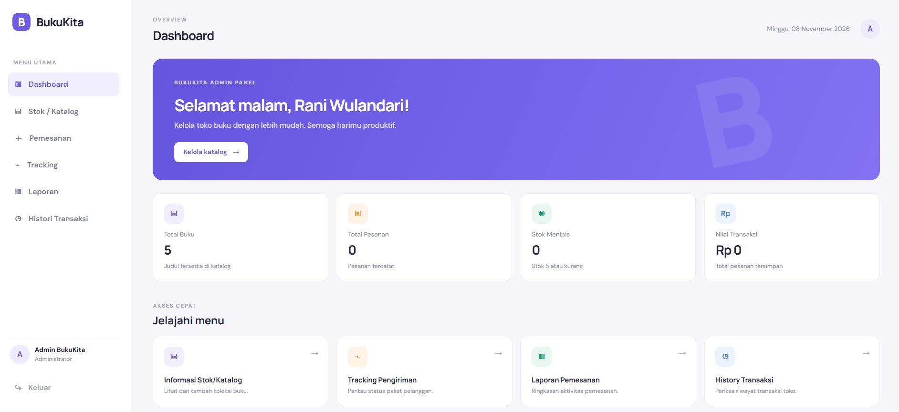
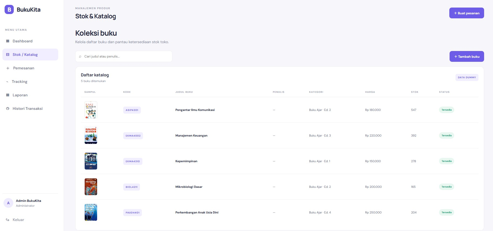
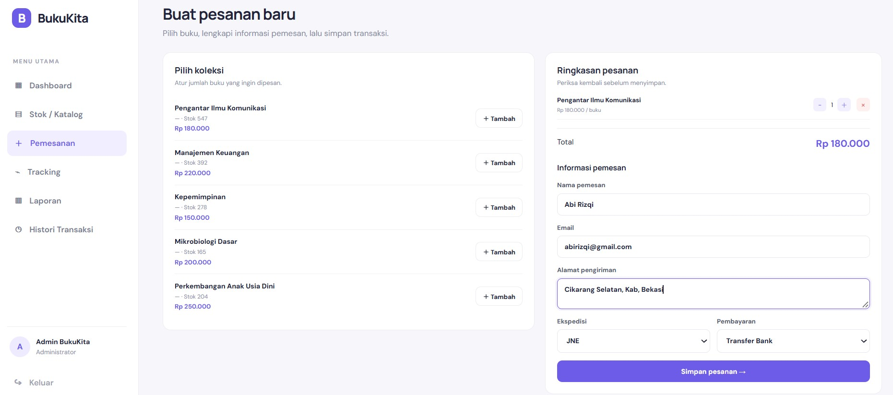
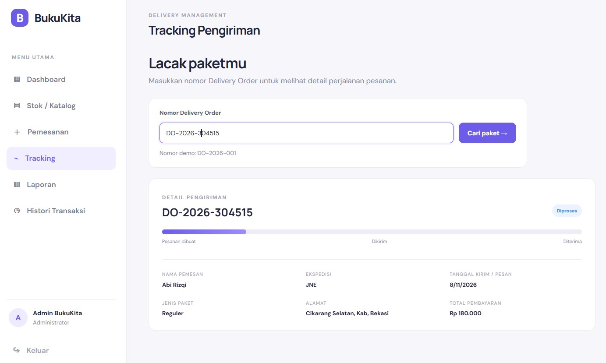
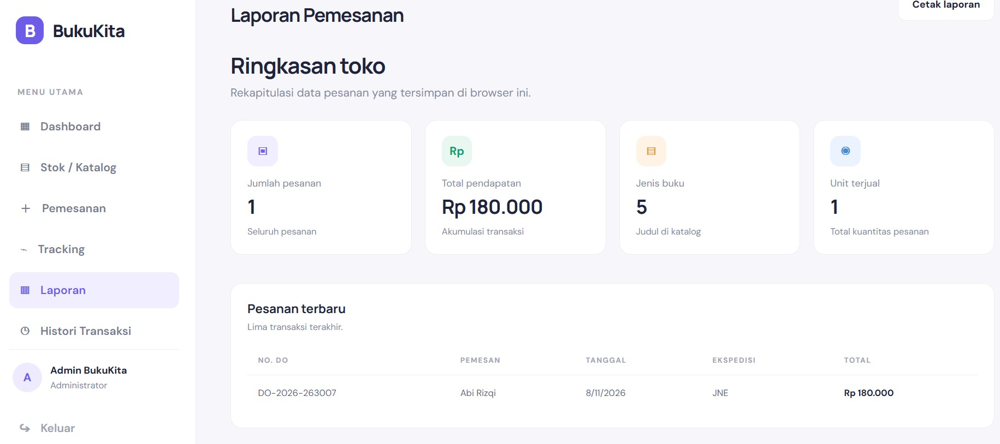
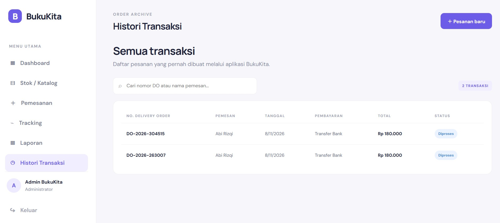

# BukuKita – Aplikasi Toko Buku Online

## 1. Deskripsi Project

**BukuKita** merupakan aplikasi toko buku online sederhana berbasis website yang dibuat untuk memenuhi tugas UTS mata kuliah Pemrograman Web 1.

Aplikasi ini dibuat menggunakan HTML, CSS, dan JavaScript. BukuKita menyediakan fitur untuk melihat katalog buku, memeriksa stok, melakukan simulasi checkout, serta melacak status pengiriman pesanan.

Aplikasi ini menggunakan data dummy yang disimpan dalam file JavaScript sehingga dapat dijalankan secara lokal tanpa membutuhkan database maupun backend.

## 2. Tujuan Pembuatan

Tujuan pembuatan aplikasi BukuKita adalah:
- Menerapkan penggunaan HTML untuk membangun struktur halaman website.
- Menerapkan CSS untuk mengatur tampilan dan tata letak website.
- Menggunakan JavaScript untuk mengolah data dan memberikan interaksi pada halaman.
- Mempraktikkan manipulasi DOM (Document Object Model).
- Membuat validasi input pada form.
- Membuat simulasi proses transaksi toko buku online.

## 3. Fitur Aplikasi

Beberapa fitur yang tersedia dalam aplikasi BukuKita adalah:

1. **Login**  
   Pengguna dapat masuk ke aplikasi menggunakan email dan password yang telah tersedia pada data dummy.

   

2. **Dashboard**  
   Menampilkan halaman utama aplikasi dan informasi ringkas toko buku.

    

3. **Stok / Katalog Buku**  
   Menampilkan daftar buku beserta kode barang, nama buku, jenis buku, edisi, jumlah stok, harga, dan gambar sampul buku.

    

4. **Checkout**  
   Menyediakan simulasi proses pemesanan buku dan perhitungan total pembayaran.

    

5. **Tracking Pesanan**  
   Menampilkan informasi status pengiriman dan riwayat perjalanan paket berdasarkan nomor DO.

    

6. **Laporan**  
   Menampilkan informasi ringkasan data transaksi.

    

7. **Transaksi**  
   Menampilkan data transaksi yang telah dilakukan.

    

## 4. Teknologi yang Digunakan

Teknologi yang digunakan dalam pembuatan aplikasi ini:

- **HTML5** – Membuat struktur halaman website.
- **CSS3** – Mengatur desain, warna, tata letak, dan tampilan website.
- **JavaScript** – Mengolah data, melakukan validasi, dan menambahkan interaksi.
- **DOM Manipulation** – Mengubah dan menampilkan elemen HTML secara dinamis.
- **Local Storage** – Menyimpan data tertentu pada browser selama simulasi aplikasi.

## 5. Struktur Folder

```text
BukuKita/
│
├── login.html
├── dashboard.html
├── stok.html
├── checkout.html
├── tracking.html
├── laporan.html
├── transaksi.html
│
├── css/
│   └── style.css
│
├── js/
│   ├── data.js
│   └── app.js
│
├── img/
│   ├── pengantar_komunikasi.jpg
│   ├── kepemimpinan.jpg
│   ├── manajemen_keuangan.jpg
│   ├── mikrobiologi.jpg
│   └── paud_perkembangan.jpg
│
└── README.md
```

## 6. Cara Menjalankan Aplikasi

Ikuti langkah-langkah berikut untuk menjalankan aplikasi:

1. Download file project BukuKita.
2. Ekstrak file ZIP ke dalam folder komputer.
3. Pastikan seluruh file HTML, folder CSS, folder JavaScript, dan folder gambar berada dalam struktur folder yang sama seperti di atas.
4. Buka folder project.
5. Jalankan file `login.html` menggunakan browser seperti Google Chrome atau Microsoft Edge.
6. Masukkan email dan password yang tersedia untuk masuk ke aplikasi.

**Catatan:** Aplikasi dijalankan secara lokal melalui browser dan tidak memerlukan instalasi database atau server backend.

## 7. Akun Login Demo

Berikut akun yang dapat digunakan untuk mencoba aplikasi:

| Nama | Email | Password | Role |
|---|---|---|---|
| Rina Wulandari | rina@gmail.com | rina123 | User |
| Agus Pranoto | agus@gmail.com | agus123 | User |
| Siti Marlina | siti@gmail.com | siti123 | Admin |

Gunakan salah satu akun di atas untuk masuk ke aplikasi.

## 8. Data Dummy

Aplikasi menggunakan data dummy yang terdapat pada file `js/data.js`.

Data tersebut terdiri dari:
- `dataPengguna` – Menyimpan informasi akun pengguna.
- `dataKatalogBuku` – Menyimpan informasi katalog dan stok buku.
- `dataTracking` – Menyimpan informasi status dan riwayat pengiriman pesanan.

Data dummy digunakan sebagai simulasi pengelolaan toko buku online tanpa menggunakan database sungguhan.

## 9. Contoh Nomor DO untuk Tracking

Berikut nomor DO yang dapat digunakan untuk mencoba fitur tracking:

- `20230012`
- `20230013`

Masukkan nomor DO tersebut pada halaman Tracking untuk melihat informasi pengiriman yang tersedia.

## 10. Pengembang

**Nama:** Muhammad Agusti Abi Rizqi
**NIM:** 312510042
**Kelas:** I253A
**Mata Kuliah:** Pemrograman Web 1  
**Tugas:** Ujian Tengah Semester (UTS)

---

**BukuKita – Toko Buku Online**

Project sederhana sebagai penerapan HTML, CSS, dan JavaScript dalam pembuatan aplikasi website interaktif.