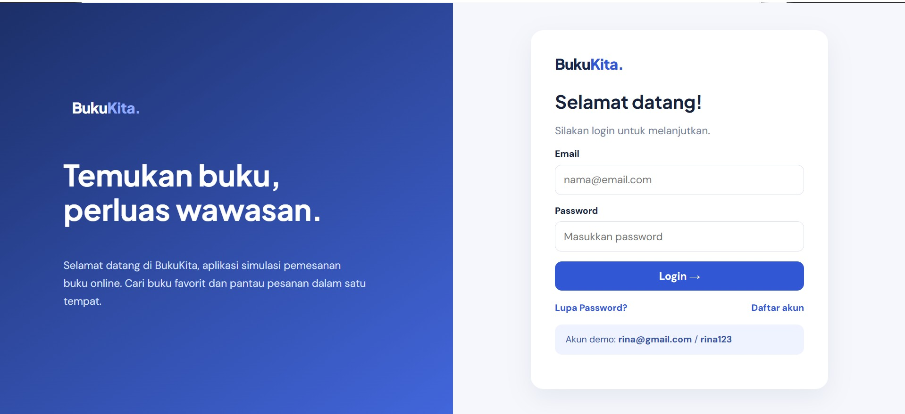
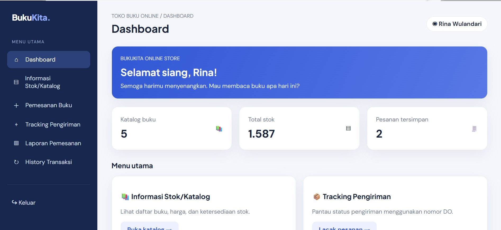
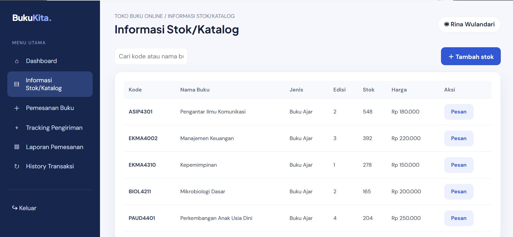
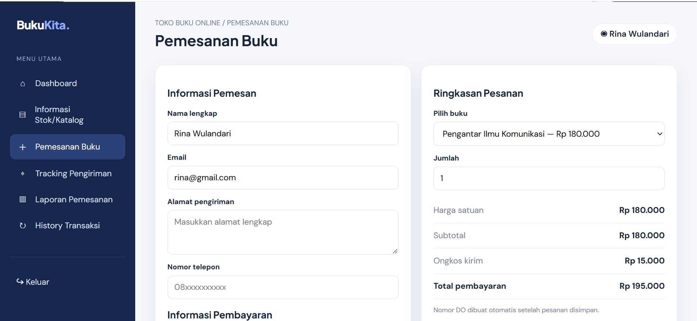
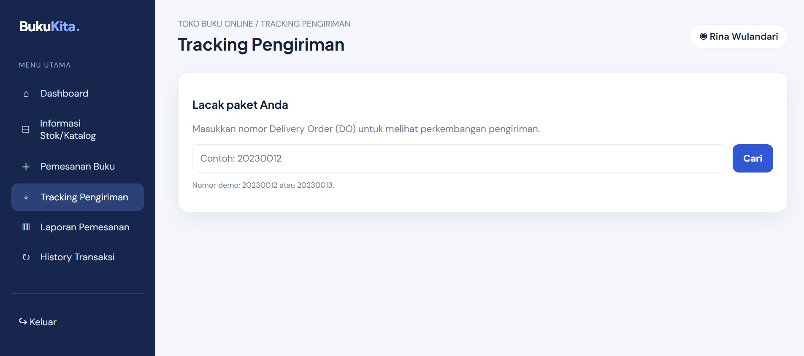
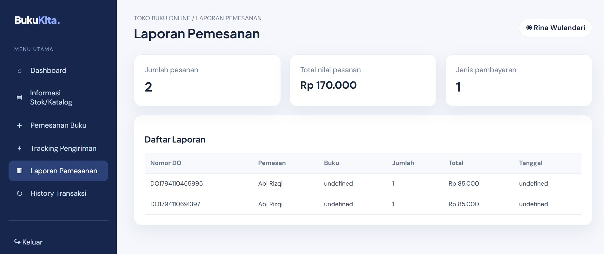
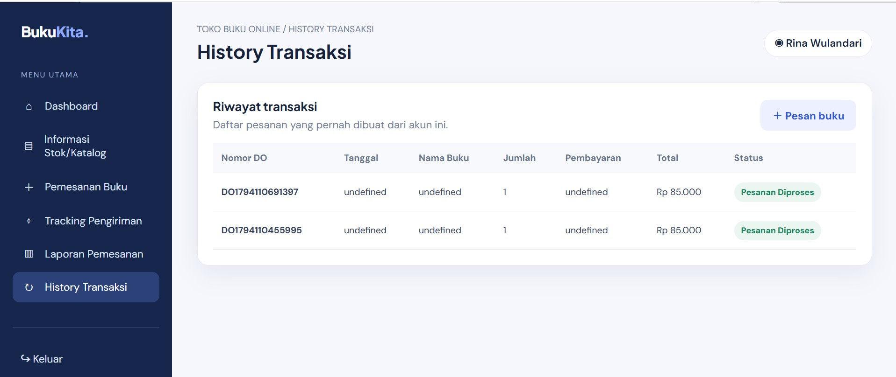

## Tugas UTS

## Identitas
- **Nama** : Muhammad Agusti Abi Rizqi
- **NIM** : 312510042
- **Kelas** : I253A 
- **Prodi / Semester** : Teknik Informatika / 3
- **Mata Kuliah** : Pemrograman Web
- **Dosen Pengampu** : Agung Nugroho, S.Kom., M.Kom

# Aplikasi Toko Buku Online

## 1. Deskripsi Proyek

Buku Store merupakan aplikasi toko buku online sederhana yang dibuat untuk memenuhi tugas Ujian Tengah Semester (UTS) mata kuliah Pemrograman Web.

Aplikasi ini dikembangkan menggunakan HTML, CSS, dan JavaScript. Tujuannya adalah menerapkan materi pemrograman web, mulai dari pembuatan struktur halaman, pengaturan tampilan, hingga penggunaan JavaScript untuk memberikan interaksi pada aplikasi.

## 2. Tujuan Pembuatan

Pembuatan aplikasi ini bertujuan untuk:

1. Membuat struktur HTML yang semantik dan valid.
2. Mengatur tampilan antarmuka menggunakan CSS.
3. Menggunakan JavaScript untuk manipulasi DOM.
4. Membuat validasi form dan interaksi pengguna.
5. Mengelola serta menampilkan data buku secara dinamis.

## 3. Fitur Aplikasi

### A. Login
- Form email dan password.
- Validasi data pengguna.
- Notifikasi jika email atau password salah.
- Fitur lupa password.
- Fitur pendaftaran akun.

## Hasilnya



### B. Dashboard
- Menampilkan halaman utama aplikasi.
- Menampilkan sapaan berdasarkan waktu.
- Navigasi menuju fitur lainnya.

## Hasilnya



### C. Informasi Stok/Katalog
- Menampilkan daftar buku.
- Menampilkan informasi kode, nama, jenis, edisi, stok, dan harga buku.
- Fitur pencarian buku.
- Menambahkan data buku menggunakan JavaScript.

## Hasilnya



### D. Checkout
- Menampilkan informasi pesanan.
- Mengisi data pembeli.
- Memilih informasi pembayaran.
- Menghitung total pembayaran.

## Hasilnya



### E. Tracking Pengiriman
- Mencari pesanan menggunakan nomor DO.
- Menampilkan nama pembeli.
- Menampilkan status pengiriman.
- Menampilkan informasi ekspedisi dan tanggal pengiriman.

## Hasilnya



### F. Laporan dan Riwayat Transaksi
- Menampilkan laporan pesanan.
- Menampilkan riwayat transaksi yang telah dilakukan.

## Hasilnya





## 4. Teknologi yang Digunakan

- **HTML5:** Membuat struktur halaman website.
- **CSS3:** Mengatur desain, warna, tata letak, dan tampilan.
- **JavaScript:** Mengatur validasi form, manipulasi DOM, pencarian data, dan interaksi pengguna.
- **LocalStorage:** Menyimpan data tertentu pada browser.

## 5. Struktur Repository

```text
Buku-Store/
│
├── login.html
├── dashboard.html
├── stok.html
├── checkout.html
├── tracking.html
├── laporan.html
├── transaksi.html
│
├── data.js
│
├── css/
│   └── style.css
│
├── js/
│   └── app.js
│
└── README.md
```

## 6. Cara Menjalankan Aplikasi

1. Download atau clone repository ini.
2. Ekstrak file jika masih berbentuk ZIP.
3. Buka folder proyek menggunakan Visual Studio Code.
4. Jalankan file `login.html` menggunakan browser.
5. Masukkan akun pengujian berikut:

| Email | Password |
|---|---|
| rina@gmail.com | rina123 |
| agus@gmail.com | agus123 |
| siti@gmail.com | siti123 |

6. Setelah berhasil login, pengguna dapat mencoba fitur yang tersedia.

## 7. Implementasi Materi UTS

Aplikasi Buku Store dibuat berdasarkan tiga indikator penilaian UTS:

**1. HTML**
- Membuat struktur halaman website.
- Menggunakan elemen form, tabel, navigasi, dan konten.
- Memisahkan halaman berdasarkan fungsi masing-masing.

**2. CSS**
- Mengatur warna dan tampilan website.
- Menggunakan file CSS eksternal.
- Membuat tampilan yang mudah digunakan.

**3. JavaScript**
- Melakukan validasi login.
- Memanipulasi elemen HTML menggunakan DOM.
- Menambahkan data buku ke tabel.
- Mengelola data transaksi.
- Membuat interaksi pada tombol dan form.

## 8. Kesimpulan

Melalui pembuatan aplikasi Buku Store, mahasiswa dapat memahami penerapan dasar HTML, CSS, dan JavaScript dalam membangun sebuah website sederhana.

Aplikasi ini juga menjadi latihan untuk menggabungkan beberapa halaman website dengan fungsi yang saling terhubung, sehingga menghasilkan sistem toko buku online yang memiliki fitur login, katalog buku, checkout, tracking, dan laporan transaksi.

---